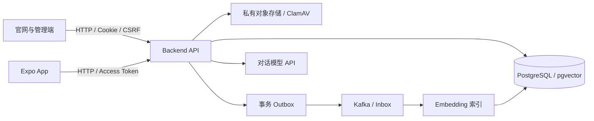

# 三仓协作与技术学习路线

凛迹雪客是面向滑雪用户、商家和平台管理员的综合服务项目。业务数据、权限、审核和 AI 凭证统一由 Backend 管理；Web 与 App 通过 HTTP/OpenAPI 协作。三个仓库分别安装依赖、检查、构建和发布，不依赖某台开发机的父目录。

## 仓库与业务地图

| 仓库                                                           | 交付物                         | 核心技术                                                            | 主要职责                                                     |
| -------------------------------------------------------------- | ------------------------------ | ------------------------------------------------------------------- | ------------------------------------------------------------ |
| [skiing-web](https://github.com/LichCarlos/skiing-web)         | 官网、管理端两个独立 Node 服务 | Next.js 16、React、Ant Design 6、React Flow、Tiptap、pnpm workspace | 内容浏览、个人中心、Web AI；内容、雪场、权限、字典和字段管理 |
| [skiing-backend](https://github.com/LichCarlos/skiing-backend) | NestJS API 与运维工具          | NestJS 11、Prisma 6、PostgreSQL 17、pgvector、Kafka                 | 认证/RBAC、业务校验、事务、审核、资产、RAG 与审计            |
| [skiing-app](https://github.com/LichCarlos/skiing-app)         | Android / iOS / Expo Web       | Expo SDK 58、React Native 0.88、Expo Router、TanStack Query         | 移动浏览、动态发布、收藏、资料、AI 对话                      |

数据库、对象存储、消息队列和模型是独立基础设施。前端不直接访问数据库或接收模型 API Key。图中的流程只表达依赖方向；服务存活不代表完整业务可用。

## 推荐学习顺序

每个阶段都完成一个可观察的结果，再进入下一阶段。时间按个人基础安排，无需同时掌握全部框架。

| 阶段              | 学习内容                                                  | 本项目阅读入口                                                                      | 实践与完成标准                                                               |
| ----------------- | --------------------------------------------------------- | ----------------------------------------------------------------------------------- | ---------------------------------------------------------------------------- |
| 1. 开发基础       | Git 分支/提交、命令行、Node、pnpm、HTTP/JSON、TypeScript  | 各仓 package.json、锁文件、.env.example                                             | 独立克隆三个仓库，使用指定包管理器完成冻结安装，说明公开变量与私有变量的区别 |
| 2. 页面与组件     | HTML/CSS、React state/effect、表单、可访问性、CSS Modules | Web apps/web/src/features、packages/ui                                              | 完成一个有空态、加载、失败状态的列表；键盘可用，不写死 API 地址              |
| 3. 前端工程       | Next App Router、Server/Client Component、workspace 边界  | Web docs/init、src/platform、config/routes.ts                                       | 添加一个只读页面，接入现有 platform 请求，边界检查与类型检查通过             |
| 4. 服务端与数据库 | Nest DI、DTO、DDD 分层、Prisma、SQL、事务/索引/migration  | Backend src/modules、prisma                                                         | 追踪一个雪场请求从 Controller 到数据库；在专用开发库新增字段并提交迁移       |
| 5. 身份与权限     | Cookie/CSRF、access/refresh、RBAC、数据范围、会话隔离     | 三仓 identity-access / platform/auth                                                | 说明前端菜单过滤与服务端授权的区别；验证普通账号无法越权读取或修改           |
| 6. 内容与配置     | 审核状态、字典树、扩展字段、资产归属、Markdown            | Web dictionaries/custom-fields/articles；Backend community/knowledge-content/assets | 用已有字典增加分类并绑定字段，完成待审→审核→公开；不把字典配置当作建 SQL 表  |
| 7. 移动端         | Expo Router、Query 缓存、SecureStore、原生与 Web 差异     | App app、src/features、src/platform                                                 | 在 Android 模拟器恢复登录、发布动态、切换账号，确认数据不串号                |
| 8. 异步与 AI      | SSE、Embedding、pgvector、Outbox/Inbox、幂等/重试         | Backend integration-events / ai-assistant                                           | 从公开来源到索引再到 AI 引用追踪一次；区分检索无结果、供应商失败和取消       |
| 9. 测试与交付     | Vitest、HTTP/数据库测试、CI、Linux 构建、Nginx、备份回滚  | .github/workflows、各仓部署教程                                                     | 用隔离数据库验证变更，产出可校验发布包，按教程部署到测试环境并演练回滚       |

## 一条适合入门的阅读路径

1. 从官网雪场列表的 route/page 开始，找到 feature 和 platform API，检查使用的 OpenAPI 类型。
2. 在 Backend 的同一路由找到 DTO、application use case、domain 规则和 repository 实现。
3. 在 Prisma schema 找到模型、引用和迁移，理解数据怎样持久化。
4. 阅读附近测试中的成功、无权限、失效引用和并发场景。
5. 对照 App 的相同业务，观察平台差异：服务端规则相同，交互与凭证存储不同。

## 业务规则须知

- 用户发布的是社区动态/个人笔记，经审核才公开；知识文章和项目知识由具备相应权限的管理流程维护。进入 RAG 还需满足来源公开、可用和索引条件。
- 数据字典维护分类、标签及可选值；字段管理维护既有业务实体的扩展字段定义和分组。配置节点不会任意新建数据库表。
- 菜单按权限和业务绑定显示；直接请求接口仍须后端验证权限及数据范围。不能把隐藏菜单当作安全措施。
- 每篇内容的图片不再设固定张数上限；单文件大小、格式、资产归属、扫描状态、文本长度和传输体积仍有约束。
- 三端 OpenAPI 当前为 1.55.0。由 Backend 导出，Web/App 同步快照和锁文件后生成类型；不要跨仓直接导入 DTO/Prisma 或复制服务实现。

## 契约协作流程

1. 在 Backend 修改规则、DTO 和 OpenAPI；运行检查与 `pnpm openapi:generate`。
2. 将 Backend 的 `contracts/openapi.json` 同步到两个客户端各自的 `contracts/openapi.json`。
3. 更新客户端 `contracts/openapi.lock.json` 的版本和快照原始字节 SHA-256，再运行 `pnpm openapi:generate` 和 `pnpm openapi:verify`。
4. 运行受影响业务与类型检查。先部署兼容客户端的 API，再发布客户端；破坏性变更需另行设计迁移期。

不要手改生成的 TypeScript 类型来掩盖契约不一致，也不要靠改锁文件跳过服务端契约验证。

## 官方学习资料

- [TypeScript Handbook](https://www.typescriptlang.org/docs/handbook/intro.html)、[React Learn](https://react.dev/learn)、[Node.js Learn](https://nodejs.org/en/learn)
- [Next.js 文档](https://nextjs.org/docs)、[Ant Design](https://ant.design/components/overview/)、[React Flow](https://reactflow.dev/learn)、[Tiptap](https://tiptap.dev/docs)
- [NestJS](https://docs.nestjs.com/)、[Prisma](https://www.prisma.io/docs)、[PostgreSQL](https://www.postgresql.org/docs/17/)、[pgvector](https://github.com/pgvector/pgvector)
- [Expo SDK 58](https://docs.expo.dev/versions/v58.0.0/)、[Expo Router](https://docs.expo.dev/router/introduction/)、[TanStack Query](https://tanstack.com/query/latest/docs/framework/react/overview)
- [Kafka](https://kafka.apache.org/documentation/)、[Git](https://git-scm.com/doc)、[GitHub Actions](https://docs.github.com/en/actions)

以仓库锁定版本为准。Next.js 和 Expo 的新版 API 有变化，学习或修改时对照本版本文档；不能把最新网站示例直接当作现有项目 API。
